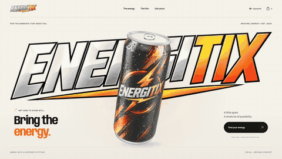

# ENERGITIX — Bring the energy.

A cinematic, interactive energy drink concept, designed and developed by **[iBithun](https://portfolio.ibithun.com)**. A single 3D can travels through a responsive product story, animated details, a liquid-splash commercial, and a playful demo shop.

**[Explore the website](https://energetix.ibithun.com)** · **[Vercel mirror](https://energitix.vercel.app)** · **[Watch the desktop teaser](https://energetix.ibithun.com/teaser.html)** · **[Work with iBithun](https://portfolio.ibithun.com)**

## Desktop teaser

Click the animated preview to open the full-resolution video with playback controls. The fresh 38-second recording of the live site, saved at 1.4× speed, scrolls through the actual desktop website from top to bottom.

[](https://energetix.ibithun.com/teaser.html)

[Watch the MP4](https://energetix.ibithun.com/media/energitix-desktop-teaser.mp4) · [Video file in this repository](public/media/energitix-desktop-teaser.mp4)

GitHub READMEs do not consistently render arbitrary HTML video players. The animated preview plays directly here; the linked player supports play/pause, seeking, fullscreen, and download. The teaser is intentionally silent, matching the website’s sound-off default.

## The experience

- **One moving 3D product.** A lathed aluminum can with a photo-derived cylindrical label, metal rims, pull tab, condensation, and drag-to-rotate interaction.
- **A scroll-led story.** GSAP and Lenis move the product between the hero, benefits, anatomy, macro photography, film, flavour, and shop sections.
- **Details that follow the can.** Projected hotspots and animated connector lines adapt to desktop and mobile layouts.
- **A scroll-controlled commercial.** An eight-second source film becomes a 192-frame image sequence with progressive loading and an aligned transition from the 3D model. Separate product compositing preserves silver highlights.
- **A working demo bag.** Single cans, six-packs and twelve-packs; quantity controls, line removal and calculated NOK totals.
- **Responsive and motion-aware.** Mobile-specific framing and typography, keyboard-operated dialogs, focus handling, and a reduced-motion mode.
- **Local assets.** Self-hosted fonts, textures, image frames and optional film audio. No API keys or backend are required.

> **Portfolio concept, not a real drink or store.** The product, citrus flavour, 330 ml size, prices and pack options are illustrative. The demo price is NOK 35 per can. No checkout, payments or orders are processed, and the bag resets on reload.

## Run locally

Use Node.js 22.12 or newer; `.nvmrc` selects Node 22.

```sh
git clone https://github.com/goldenbutter/energitix.git
cd energitix
npm ci
npm run dev
```

Open the URL printed by Vite, normally `http://localhost:5173`.

| Command | Purpose |
| --- | --- |
| `npm run dev` | Start the local development server |
| `npm run build` | Build the static site into `dist/` |
| `npm run preview` | Serve the production build locally |
| `npm run test:visual` | Check desktop/mobile layouts and demo bag interactions |
| `npm run test:film` | Check film transitions, reverse scrolling, complete title pixels and delayed media in Chromium/WebKit |
| `npm run record:teaser` | Re-record the desktop tour and create MP4/GIF outputs |

## Stack and structure

React 18 · Vite · Three.js · GSAP ScrollTrigger · Lenis · Manrope / Anybody variable fonts.

```text
src/
  main.jsx                 Page sections, dialogs and demo bag state
  product-scene.js         3D can, materials, travel and projected hotspots
  film.js                  Scroll sequence, audio, masking and compositing
  film-layout.js           Shared framing for the video and 3D handoff
  style.css                Desktop/mobile styling and motion preferences
public/
  assets/                  Product textures, wordmark, macros, frames and audio
  media/                   Teaser MP4, animated README preview and poster
  teaser.html              Accessible standalone video player
scripts/
  process_assets.py        Rebuild supplied photo/video assets
  prepare_can_masks.py     Rebuild source-aligned product alpha masks
  record-teaser.mjs         Capture the desktop tour
  finalize-teaser.mjs       Remove capture stalls and encode MP4/GIF
  verify.mjs               Browser and interaction checks
MASTER-PROMPT.md            Reusable brief and approved concept choices
ASSET-NOTES.md              Asset edits and film compositing notes
WORDMARK.md                 Wordmark design and generation reference
vercel.json                Static Vite deployment settings
```

The original `bottle.png` and commercial MP4 are preserved at the repository root. Temporary analysis, local recordings, virtual environments, build output, dependencies and Vercel credentials are excluded from Git.

## Verification

With the dev server running on port 5173:

```sh
npx playwright install chromium
npm run test:visual
```

The script captures 15 scroll positions at 1440 × 900 and 390 × 844, plus bag screenshots. It checks browser errors, horizontal overflow, pack prices, quantity changes, subtotals, Escape dismissal, item removal, and reduced-motion rendering. Screenshots and the JSON report are saved in ignored `analysis/` files. Browser emulation does not replace physical-device testing.

To check another deployment:

```sh
BASE_URL=https://energetix.ibithun.com npm run test:visual
```

### Film transition regression checks

```sh
npx playwright install chromium webkit
npm run test:film
```

The focused suite checks seven viewport sizes in Chromium and WebKit, including phones, tablet, landscape and desktop. It samples film entry, playback and exit in both scroll directions, compares the entering title against an unoccluded pixel reference, and delays product mattes to verify the 3D fallback remains visible. Reduced-motion loading is checked separately. Reports and screenshots go to `analysis/film-verification/`. See [TESTING.md](TESTING.md) for the verified matrix and regression details.

### Splash lettering checks

With the Python asset-processing environment installed, run `npm run test:splash` to compare visible letter pixels across 18 film frames in desktop and phone viewports, in Chromium and WebKit. The moving liquid must not change the uncovered black or ivory letters. Results are stored in `analysis/splash-verification/`.

## Re-create the teaser

Install ffmpeg (including ffprobe) and Playwright Chromium. For a stable recording without development-server reloads, run `npm run build` and `npm run preview -- --port 4173`, then in another terminal:

```sh
TEASER_URL=http://localhost:4173 npm run record:teaser
```

The recorder captures a 1600 × 900 desktop tour, including the pinned anatomy and commercial sections, ending on the iBithun footer. It exports an H.264 MP4 with fast-start playback, an animated GIF at the same 1.4× speed for GitHub, and a JPEG poster into `public/media/`. `TEASER_URL` can point at a different running deployment. Raw recordings and timing receipts stay in ignored `analysis/teaser-recording/`.

## Rebuild the product assets

With Python 3 and ffmpeg installed:

```sh
python3 -m venv .venv
.venv/bin/pip install pillow numpy scipy
.venv/bin/python scripts/process_assets.py
.venv/bin/python scripts/prepare_can_masks.py
```

Measurements and silhouettes are specific to the supplied photo and film. Update them before adapting the processor to a different product. The unseen back of the can is a designed interpretation. AI-generated visual assets are used in this fictional portfolio concept; see the asset notes for provenance and edits.

## Deployment

Vercel builds this repository with `npm ci` and `npm run build`, then serves `dist/`. No environment variables are required. The production branch is `main`.

The requested custom hostname is **`energetix.ibithun.com`** (spelled exactly as requested); the product branding and repository are **ENERGITIX / energitix**. DNS for `ibithun.com` is managed outside Vercel. Domain setup and deployment status are recorded in [DEPLOYMENT.md](DEPLOYMENT.md).

## Credits and contact

Designed and developed by **Bithun Chatterjee / iBithun**.

- [Portfolio](https://portfolio.ibithun.com)
- [iBithun](https://ibithun.com)
- [LinkedIn](https://www.linkedin.com/in/bithun-chatterjee)
- [Email](mailto:bithun@ibithun.com)

Interested in a product website for your own brand? [Let’s make something.](https://portfolio.ibithun.com)

This public repository is a portfolio showcase. No open-source license is granted; contact the author before reusing the design or media. Third-party packages and fonts retain their own licenses.
